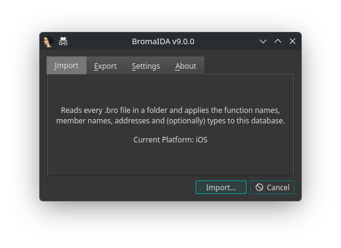
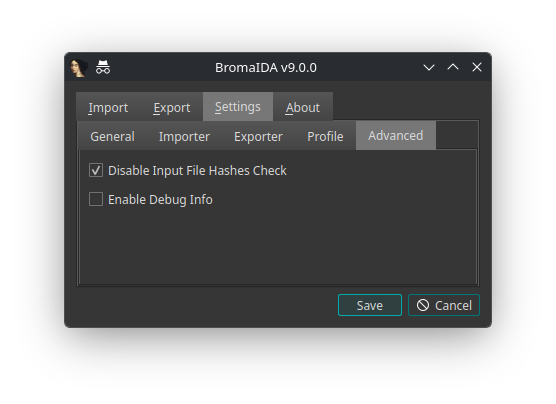

# BromaIDA

Broma support for IDA. It applies the [Geode bindings](https://github.com/geode-sdk/bindings) to your IDB (names, signatures, types and vtables) and can export what you've reversed back into Broma.

> [!WARNING]
> The C++ rewrite is experimental, so expect any bugs. If you do find any, please report them through Issues.



## Features

- **Import bindings:** names functions at the addresses in the `.bro` files and asks before overwriting anything you wrote.
- **Import types** (needs IDAClang): classes, vtables, members, signatures and argument names.
- **Export bindings:** writes addresses into an existing `.bro` file without touching its comments or formatting, and adds missing methods and classes.
- **Export current function:** right-click in the disassembly or pseudocode view.

## Requirements

- IDA Pro 9.4
- IDAClang, only for type import

## Installation

Put these in IDA's plugin folder (`~/.idapro/plugins/` on Linux and macOS, `%APPDATA%\Hex-Rays\IDA Pro\plugins\` on Windows) and restart IDA:

```
plugins/bromaida.so       (.dll on Windows, .dylib on macOS)
plugins/bromaida/         the profiles/, sdk/ and stl/ folders from the release
```

Without the `bromaida` folder the plugin loads, but type import won't run.

## Usage

Wait for `AU: idle`, then open **Edit → Plugins → BromaIDA** or press `Ctrl+Shift+B`.

**Import** asks for the folder with your `.bro` files, for example `bindings/2.2091`. It uses `Entry.bro` if there is one, otherwise it merges every `.bro` in the folder. Type import runs once per database and can take a few minutes.

**Export** asks for the `.bro` file to write into. A missing file is created.

The platform is detected from the binary.

### Scripting

For batch jobs and idalib, set `BROMAIDA_FILE` and run the plugin with `1` (import) or `2` (export):

```python
import ida_loader
ida_loader.load_and_run_plugin("bromaida", 1)
```

## Settings

Open them from the plugin menu and hover over an option for details.



If an import leaves broken types behind, delete the `BromaIDA` folder in Local Types, save the IDB and import again.

## Building

Needs CMake 3.31+, Ninja, Clang 20 or newer (C++23 required) and Qt 6.8 (the version IDA ships with).

```sh
cmake --preset linux-release
cmake --build --preset linux-release
ctest --preset linux-release
```

Presets also exist for `macos-arm64`, `macos-x64` and `windows-x64`. If CMake can't find Qt, pass `-DBROMAIDA_QT_DIR=<path to the 6.8 kit>`.

To get Qt 6.8, use [aqtinstall](https://github.com/miurahr/aqtinstall), which puts it in `~/Qt/6.8.2/gcc_64` on Linux:

```sh
pip install aqtinstall
aqt install-qt linux desktop 6.8.2 linux_gcc_64
```

## Acknowledgements

- [Geode](https://github.com/geode-sdk) for the bindings and the [Broma](https://github.com/geode-sdk/Broma) parser.
- The [IDA SDK](https://github.com/HexRaysSA/ida-sdk).
- [CallocGD](https://github.com/CallocGD) and [Prevter](https://github.com/Prevter) for [PyBroma](https://github.com/prevter/PyBroma), which the Python version was built on.
- @sleepyut: issuing 3 trillion bug reports, and suggesting a bunch of features. (They also made BromaBJ.)
- [AngelDev06](https://github.com/AngelDev06): contributing features.
